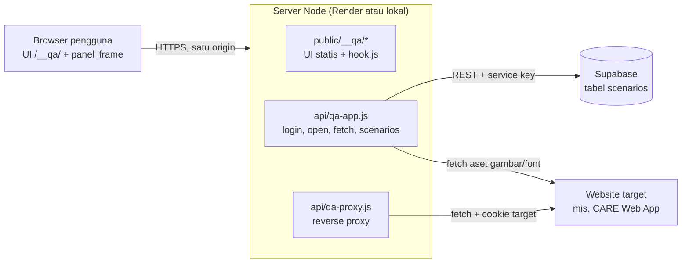
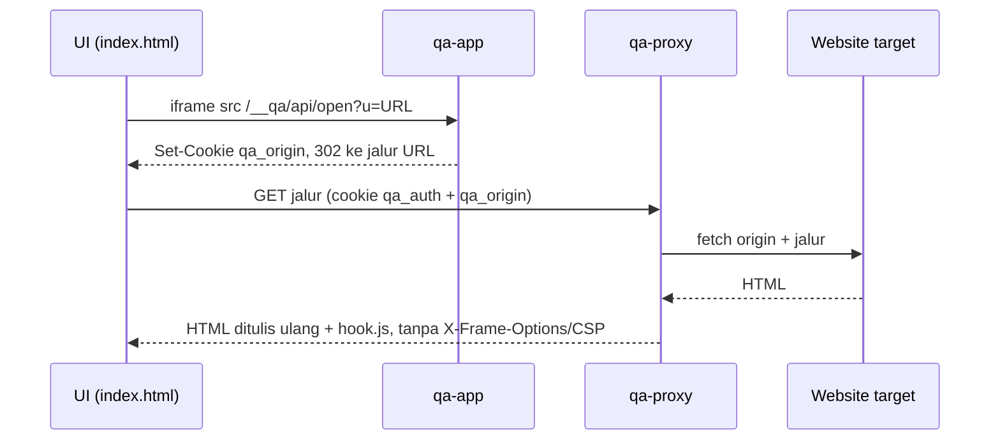

# ARCHITECTURE.md — QA Recorder

> Struktur aplikasi, teknologi, dan cara semua komponen terhubung.
> Dokumen terkait: [PRODUCT-REQUIREMENTS.md](PRODUCT-REQUIREMENTS.md) · [DESIGN-SYSTEM.md](DESIGN-SYSTEM.md) · [AI-AGENTS.md](AI-AGENTS.md)

Dokumen ini menjelaskan kode **sebagaimana adanya**. Hal yang tidak diketahui pasti ditandai **(asumsi)**.

---

## 1. Gambaran besar

Aplikasi terdiri dari **satu halaman statis** (UI, vanilla JavaScript) dan **dua fungsi server kecil** (Node), ditambah **Supabase** untuk menyimpan skenario.

Ide intinya: website target dimuat **lewat reverse proxy milik aplikasi**, sehingga halaman target dan UI berada pada **origin yang sama**. Itu membuat UI bisa membaca DOM, mendengarkan event, dan mengendalikan halaman target di dalam iframe, tanpa extension dan tanpa browser headless di server.



## 2. Teknologi

| Lapisan | Pilihan | Alasan |
|---|---|---|
| UI | HTML + CSS + JavaScript murni dalam **satu berkas** (`public/__qa/index.html`) | Tanpa build step, mudah di-deploy dan dibaca. |
| Pustaka UI | **JSZip** (di-vendor, `public/__qa/jszip.min.js`) | Satu-satunya dependensi: membuat berkas `.docx`. |
| Server | **Node ≥ 20.12** (`fetch` bawaan, `process.loadEnvFile`) | Tanpa dependensi npm. |
| Bentuk fungsi | `module.exports = async (req, res) => {}` (gaya serverless) | Bisa dibungkus server Node biasa (`dev.js`) maupun platform serverless. |
| Database | **Supabase** (PostgREST, tabel `scenarios`) | Penyimpanan skenario terpusat. |
| Hosting | **Render.com** (dikonfirmasi pengguna: berjalan lancar) | Server Node biasa; lihat bagian Deployment. |
| Uji | `node --test` (unit) + skrip e2e Playwright yang dipakai saat pengembangan (belum ada di repo) | Lihat bagian Pengujian. |

## 3. Struktur repositori

```
.
├── api/
│   ├── _lib.js          # util bersama: token, parse cookie, authed, badHost, readBody
│   ├── qa-app.js        # API aplikasi: login, ping, open, fetch, scenarios
│   └── qa-proxy.js      # reverse proxy ke website target
├── public/__qa/
│   ├── index.html       # seluruh UI + logika klien (±1100 baris)
│   ├── hook.js          # disisipkan ke setiap halaman target, memanggil window.top.__qa.patch
│   ├── jszip.min.js     # vendor
│   └── logo.png         # logo di pojok kiri bawah
├── test/proxy.test.js   # unit test proxy
├── dev.js               # server Node: meniru rewrite, menyajikan statis, memanggil api/*
├── vercel.json          # aturan rewrite (peninggalan Vercel; dev.js memakai logika yang sama)
├── .env.example         # QA_PASSWORD, SUPABASE_URL, SUPABASE_SERVICE_KEY, ALLOW_PRIVATE_HOSTS
├── package.json         # skrip: dev, test
└── README.md
```

Pembagian jalur URL (inilah "kontrak" routing):

| Jalur | Ditangani oleh |
|---|---|
| `/__qa/api/<nama>` | `api/qa-app.js` (parameter `r=<nama>`) |
| `/__qa/*` | berkas statis di `public/__qa/` |
| **semua jalur lain** (termasuk `/`) | `api/qa-proxy.js` → diteruskan ke website target |

Karena jalur lain diteruskan ke target, **aplikasi sendiri hanya memakai awalan `/__qa/`** agar tidak bentrok dengan jalur target.

## 4. Komponen server

### 4.1 `dev.js`
Server `http` yang menggantikan routing platform: memetakan `/__qa/api/:r` ke `qa-app`, menyajikan `public/` untuk `/__qa/*`, dan meneruskan sisanya ke `qa-proxy` dengan jalur asli di parameter `p`. Memuat `.env` sendiri (`process.loadEnvFile`) dan mencetak status env saat start. Mendengarkan **port 3000** (tetap).

### 4.2 `api/qa-app.js` — API aplikasi
| Rute (`/__qa/api/…`) | Metode | Auth | Fungsi |
|---|---|---|---|
| `login` | POST `{password}` | tidak | Bila cocok `QA_PASSWORD`, set cookie `qa_auth`. 401 bila salah, 500 bila env kosong. |
| `ping` | GET | ya | 200 bila sudah login, 401 bila belum (UI memakainya saat boot). |
| `open?u=<url>` | GET | ya | Validasi URL (http/https, bukan host privat kecuali `ALLOW_PRIVATE_HOSTS`), set cookie `qa_origin`, redirect `302` ke jalur URL itu pada domain aplikasi. |
| `fetch?u=<url>` | GET | ya | Mengambil **gambar/font** lintas domain untuk screenshot (maks 5 MB, redirect ditolak, tipe selain gambar/font → 415). |
| `scenarios` | GET | ya | Daftar `{id,name,created_at}` (maks 100, terbaru dulu); `?id=<uuid>` mengembalikan satu baris lengkap. |
| `scenarios` | POST | ya | Membuat skenario `{name, data:{baseUrl,steps}}`. Validasi: `name` wajib (dipotong 100 karakter), `data.steps` array. |
| `scenarios?id=<uuid>` | PATCH | ya | Menimpa skenario (validasi sama). |

Catatan implementasi Supabase: URL dinormalisasi (hapus `/` akhir dan `/rest/v1`); key berawalan `eyJ` dikirim juga sebagai `Authorization: Bearer`, key baru (`sb_secret_…`) **hanya** lewat header `apikey`; key `anon`/`publishable` ditolak dengan pesan jelas. Semua kesalahan dikembalikan sebagai JSON `{error}`.

### 4.3 `api/qa-proxy.js` — reverse proxy
Alur satu permintaan:

1. Wajib login (`401` bila tidak). Tanpa cookie `qa_origin` → redirect ke `/__qa/`.
2. Target = `qa_origin` + jalur (`p`) + query.
3. Meneruskan hanya header terpilih (`accept`, `accept-language`, `content-type`, `user-agent`, `x-requested-with`, `authorization`) dan cookie target (tanpa `qa_auth`/`qa_origin`). Untuk metode bukan GET/HEAD, `origin` dan `referer` diisi dengan origin target.
4. `fetch` dengan `redirect: 'manual'`; kegagalan jaringan → `502 proxy gagal: …`.
5. Header respons: dibuang `content-encoding`, `content-length`, `transfer-encoding`, `connection`, `x-frame-options`, `content-security-policy(-report-only)`, `strict-transport-security`, dan `set-cookie` diganti versi tanpa `Domain=`. Header `Location` yang menunjuk origin target diganti ke origin aplikasi.
6. Untuk respons HTML/JS/CSS: **penggantian teks** origin target (dan `//host-target`) menjadi origin aplikasi.
7. Untuk HTML hasil navigasi (`sec-fetch-dest` = `document`/`iframe`/`frame`, atau header tak ada): sisipkan `<script src="/__qa/hook.js">` **tepat sesudah doctype** (atau di awal bila tak ada doctype), supaya mode render (standar/quirks) tidak berubah dan hook jalan sebelum script halaman.

### 4.4 `api/_lib.js`
`token()` = SHA-256 dari `'qa:' + QA_PASSWORD` (nilai cookie `qa_auth`); `authed(req)` membandingkan cookie; `badHost(host)` memeriksa host privat berdasarkan **literal** (tanpa resolve DNS); `readBody(req)` membaca stream.

## 5. Klien (`public/__qa/index.html`)

Satu berkas dengan bagian-bagian berikut (urutan di berkas):

| Bagian | Isi utama |
|---|---|
| auth | `boot()`, login. |
| skenario baru / daftar DB | `loadDb`, `drawList`, `openDb`, simpan (POST/PATCH), pencarian. |
| panel tab | `mkTab`, `show`, `closeTab`, `resetTabs`, `window.__qa.patch`, `onLoad`, `tabOf`, `framePath`. |
| navigasi | `go()`; address bar. |
| selector | `sel()` (membuat), `find()` (menemukan), `frameDoc()`. |
| rekam | `attach()` (pendengar event per dokumen), `add()`, `typeStep`, `dupType`. |
| edit langkah | `render()` daftar langkah. |
| JSON | unduh, unggah, gabung (`load`, `readFiles`). |
| jalankan | `exec()`, `settle()`, event sintetis (`fire`, `hoverOn`, `pressKey`), dialog (`dialogAnswer`). |
| screenshot | `snapWin()`, `expandScrollers()`, `toData()`, `inlineUrls()`, `shot()`. |
| laporan | `describe()`, `model()`, `toHtml()`, `toMd()`, `toDocx()`, ekspor PDF/DOCX. |

### 5.1 State global (di memori halaman, tidak disimpan)

| Variabel | Arti |
|---|---|
| `steps` | Array langkah skenario yang sedang dibuka. |
| `res` | Hasil per langkah: `{ok, err, ms, note, before, img, iw, ih, shotErr}`. |
| `meta` | `{name, base, start, end, final}` untuk laporan. |
| `base` | Origin target (mis. `https://host:9444`). |
| `tabs`, `active`, `nextId` | Tab panel: `{id, f(iframe), opener, label, reqs[], navAt, loadedAt}`. |
| `recording`, `assertMode` | Mode rekam. |
| `rows`, `curId`, `dbOk`, `dbErr` | Daftar skenario dari DB. |
| `running`, `dlgQueue`, `dlgSeen`, `curCtx` | Penjawab dialog saat replay. |

Penanda pada objek DOM: `document.__qa` (pendengar sudah terpasang — juga dipakai sebagai tanda "dokumen siap"), `document.__qaHov`, `document.__qaHoverCss`, `window.__qaPatched`, `element.__qaInit` (nilai awal field).

## 6. Model data

### 6.1 Skenario (JSON dan DB)
```json
{
  "name": "Login Input Simple Polis",
  "baseUrl": "https://aig-vn-sit.care.co.id:9444",
  "steps": [
    { "action": "goto",  "selector": "", "value": "/CareWebApplicationV5/" },
    { "action": "type",  "selector": "#TxtUserID", "value": "care" },
    { "action": "type",  "selector": "#TxtPwd", "value": "…", "sensitive": true },
    { "action": "click", "selector": "#BtnSignOn", "value": "", "label": "Sign On" },
    { "action": "press", "selector": "#ctl00_…_TxtNewPolicyType", "value": "F2" },
    { "action": "click", "selector": "cell=Individual Policy", "value": "", "tab": 1, "frame": "#dialog-body" },
    { "action": "dialog", "kind": "confirm", "selector": "Save policy data ?", "value": "accept" }
  ]
}
```

Field langkah:

| Field | Tipe | Arti |
|---|---|---|
| `action` | string | `goto`, `click`, `dblclick`, `hover`, `dialog`, `type`, `select`, `press`, `assertText` |
| `selector` | string | CSS, `text=<teks tombol/tautan>`, `cell=<teks sel/baris>`. Untuk `dialog`: **teks pesan** (kosong = tidak dicek). Untuk `goto`: kosong. |
| `value` | string | `goto`: jalur+query · `type`/`select`: nilai · `press`: kunci (`F2`, `Escape`, `Ctrl+S`, `Enter`) · `assertText`: teks yang diharapkan · `dialog`: `accept` / `dismiss` / `accept:<isian prompt>` |
| `tab` | number (opsional) | Nomor tab panel (0 = utama; dihilangkan bila 0). |
| `frame` | string (opsional) | Rantai selector iframe dari dokumen tab, dipisah ` >> ` (mis. `#dialog-body`). |
| `kind` | string (khusus `dialog`) | `alert` / `confirm` / `prompt`. |
| `label` | string (opsional) | Nama terbaca manusia untuk elemen (dari `title`/`alt`/`value`/teks). |
| `sensitive` | boolean (opsional) | Nilai disamarkan di laporan (kolom password). |

Nomor tab ditetapkan **urut kemunculan** sejak `goto`/Buka (counter di-reset), sehingga replay harus membuka tab dalam urutan yang sama seperti saat rekam.

### 6.2 Tabel Supabase
```sql
create table scenarios (
  id uuid primary key default gen_random_uuid(),
  name text not null,
  data jsonb not null,            -- { baseUrl, steps }
  created_at timestamptz default now()
);
alter table scenarios enable row level security;   -- tanpa policy: hanya service key
grant usage on schema public to service_role;      -- wajib di project baru
grant all on table public.scenarios to service_role;
```
Aplikasi memakai **service key di server**; klien tidak pernah menerima key Supabase.

## 7. Alur utama

### 7.1 Membuka website target


### 7.2 Siklus hidup hook di halaman target
`hook.js` dijalankan **sebelum script halaman** pada setiap dokumen (juga iframe bersarang) dan memanggil `window.top.__qa.patch(window)`. `patch(w)`:

1. Mencari tab pemilik (`tabOf`) dan jalur frame (`framePath`).
2. Memasang `attach()` — semua pendengar perekam — sejak awal dokumen.
3. Memasang pelacak status halaman: `beforeunload`, `load`, dan pembungkus `XMLHttpRequest.send`/`fetch` (untuk `settle`).
4. Membungkus `alert`/`confirm`/`prompt` (rekam saat merekam, jawab otomatis saat replay).
5. Membungkus `window.open` (membuka tab panel), dan untuk jendela tab: `window.close`, `window.opener`.

Dokumen tanpa hook (mis. tak melewati proxy dengan header navigasi) tetap diperbaiki oleh `onLoad` setelah event `load`.

### 7.3 Perekaman
`attach(d, tabId, frame)` memasang pendengar pada dokumen:

- `click` (capture) → langkah `click`; klik pada field teks dilewati (`TEXTY`), kecuali tombol image/reset/file dan sejenisnya.
- `change`, `keydown` (F-key, Escape, Ctrl/Alt+huruf, Enter di input) → `type`/`select`/`press`. Nilai yang belum "change" dicatat sebelum tombol ditekan; duplikat dibuang oleh `dupType`.
- `dblclick` → mengganti dua `click` terakhir dengan satu `dblclick`.
- **Hover**: `MutationObserver` mencatat perubahan elemen (bukan teks); `mouseover` dianggap pemicu sub menu bila elemen **lain** (bukan dirinya/anak/induknya) berubah dalam jendela waktu hover itu, dengan gerakan kursor nyata di sekitarnya. Kandidat dikeluarkan sebagai langkah `hover` tepat sebelum klik berikutnya.
- Dialog bawaan dicatat oleh pembungkus `alert/confirm/prompt` di `patch`.

### 7.4 Pemutaran ulang (`run` → `exec`)
Untuk setiap langkah:

1. Pasang jawaban dialog: langkah `dialog` yang **menyusul** langkah ini dimasukkan ke `dlgQueue` sebelum langkah dijalankan (karena `confirm()` dipanggil sinkron saat klik).
2. `exec(step)`: pilih tab dan dokumen (`frameDoc` bila ada `frame`), tunggu elemen (5 dtk; hover 2,5 dtk; iframe 15 dtk) dan tunggu penangkap terpasang (`document.__qa`).
3. Eksekusi: `click`/`dblclick` (event mouse lengkap + `click()`), `press` (`pressKey`: fokus, keydown → keypress → keyup dengan `keyCode`), `type`/`select` (setter nilai asli + event `input`/`change`, aman untuk React), `hover` (`hoverOn`), `assertText`, `dialog` (verifikasi), `goto`.
4. `settle()`: tunggu halaman siap (lihat 7.5).
5. Ambil screenshot sesudah langkah; simpan hasil ke `res[i]`. Berhenti bila gagal.
6. Setelah semua langkah: tampilan akhir (atau keadaan saat error).

### 7.5 Menunggu halaman siap (`settle`)
Halaman **siap** bila semuanya terpenuhi dan stabil `quiet` ms (300; 150 untuk screenshot):

- tidak ada navigasi berjalan (`beforeunload` terjadi lebih baru dari `load`, dalam 20 dtk),
- dokumen dan iframe bersarang `readyState === 'complete'`,
- semua `` selesai (kecuali `loading=lazy`),
- tidak ada XHR/fetch yang berjalan (permintaan > 8 dtk diabaikan).

Batas total 15 dtk; bila lewat, replay lanjut dan langkah diberi catatan.

### 7.6 Screenshot (`snapWin`)
Teknik: **render ulang DOM oleh browser** memakai SVG `<foreignObject>`, bukan library.

1. `expandScrollers`: kotak ber-`overflow:auto|scroll` dibuka sementara (hanya pada dokumen utama, bukan iframe bersarang) → ukur lebar/tinggi konten → `cloneNode` → kembalikan style dan posisi scroll. Semuanya sinkron (tanpa repaint).
2. Sorotan (kotak merah) dihitung pada tata letak terbuka dan ditambahkan ke **salinan**.
3. Salin nilai form saat ini, ganti `<canvas>` jadi gambar, buang `script/link/style/iframe/object/embed`, bersihkan tag/atribut ber-namespace.
4. Inline aset: ``, `input[type=image]`, atribut `background`, `style="…url()"`, dan `url()` di stylesheet (termasuk `@font-face`) → data URI. Same-origin diambil langsung; domain lain lewat `/__qa/api/fetch`.
5. `<iframe>` bersarang dirender rekursif (maks kedalaman 3, skala 1) dan dipasang sebagai gambar latar pada `span` seukuran iframe.
6. Serialisasi XML → SVG → `Image` → `canvas` (skala 2, turun otomatis bila piksel > 20 juta) → JPEG 0,85.

Batas: lebar 4000 px, tinggi 10000 px (bersarang 5000), timeout 25 dtk. Kegagalan menghasilkan `{shotErr}` dan tidak menggagalkan langkah.

### 7.7 Laporan
`model(lang)` mengubah `steps` + `res` + `meta` menjadi struktur netral; lalu `toHtml`, `toMd` (gambar sebagai data URI), `toDocx` (OOXML dibuat manual dengan JSZip; gambar selebar 6 inci), dan PDF (halaman HTML dibuka di jendela baru lalu `print()`). Deskripsi langkah dihasilkan `describe()` dari kamus `D` (id/en) dan kamus label `I`.

## 8. Keamanan

| Aspek | Mekanisme | Catatan |
|---|---|---|
| Autentikasi | Password tunggal; cookie `qa_auth` (SHA-256), `HttpOnly; SameSite=Lax; Secure` | Tidak ada rate limit. |
| Otorisasi | Semua rute API (kecuali `login`) dan proxy memeriksa `authed()` | — |
| SSRF | `badHost()` menolak host privat (literal) pada `open` dan `fetch`; `ALLOW_PRIVATE_HOSTS=1` hanya untuk lokal | Tidak me-resolve DNS (rentan DNS rebinding); redirect pada `fetch` ditolak. |
| Rahasia | Service key Supabase hanya di server (env); `.env` ada di `.gitignore` | JSON skenario menyimpan nilai password **polos**. |
| Isolasi target | Iframe memakai `sandbox` tanpa `allow-top-navigation` (frame-busting tidak bisa mengarahkan halaman aplikasi) | Karena `allow-same-origin` + `allow-scripts`, halaman target dipercaya setara aplikasi. Hanya uji situs yang dipercaya. |
| Header | `X-Frame-Options`, CSP, HSTS dari target dibuang agar bisa di-iframe | Disengaja. |

## 9. Konfigurasi

| Env | Wajib | Fungsi |
|---|---|---|
| `QA_PASSWORD` | ya | Password aplikasi. |
| `SUPABASE_URL` | untuk DB | URL proyek Supabase. |
| `SUPABASE_SERVICE_KEY` | untuk DB | Secret/service_role key. Tanpa dua env Supabase, fitur DB nonaktif dan JSON tetap berfungsi. |
| `ALLOW_PRIVATE_HOSTS` | tidak | `1` = izinkan target host privat. **Jangan** di server publik. |

## 10. Deployment

| Topologi | Keterangan |
|---|---|
| **Lokal** | `npm run dev` → `http://localhost:3000/__qa/`. Cookie `Secure` tetap diterima Chrome/Firefox di `localhost`. |
| **Render.com (saat ini)** | Web Service Node. Berjalan lancar menurut pengguna. **(Asumsi)** perintah start `node dev.js` dengan env diisi di dashboard. Catatan: `npm run dev` memakai `node --env-file=.env`, dan Node berhenti dengan galat `.env: not found` bila berkas itu tidak ada (sudah dicoba); `node dev.js` aman karena memuat `.env` sendiri bila ada. Port dibuat tetap 3000 di `dev.js`; Render biasanya menyediakan `PORT` — bila perlu, ubah `listen(3000)` menjadi `listen(process.env.PORT \|\| 3000)`. |
| **Vercel (peninggalan)** | `vercel.json` dan struktur `api/` masih ada dan pernah dipakai; tidak lagi dipakai. Batas diketahui: respons ≤ 4,5 MB. |

Syarat jaringan: **server harus bisa menjangkau website target.** Target internal yang hanya bisa dibuka lewat VPN menuntut aplikasi dijalankan di dalam jaringan itu.

## 11. Batas dan konstanta

| Hal | Nilai |
|---|---|
| Tunggu elemen | 5 dtk (hover 2,5 dtk; di iframe 15 dtk) |
| `settle` | maks 15 dtk; stabil 300 ms (screenshot 150 ms); abaikan XHR > 8 dtk; navigasi basi > 20 dtk |
| Screenshot | lebar ≤ 4000, tinggi ≤ 10000 px; skala 2 (min 0,4); ≤ 20 juta piksel; JPEG 0,85; timeout 25 dtk; iframe bersarang ≤ 3 tingkat |
| Hover direkam | jendela 300 ms setelah `mouseover`; gerakan kursor −200…+320 ms; kandidat kedaluwarsa 15 dtk |
| `fetch` aset | ≤ 5 MB; hanya gambar/font |
| Daftar skenario | 100 terbaru |

## 12. Pengujian

- **Unit** (`npm test` → `test/proxy.test.js`): proxy membuang header frame, menulis ulang origin, meneruskan body/cookie, menolak tanpa login, memblokir host privat, dan menyisipkan hook sesudah doctype.
- **E2E**: selama pengembangan, setiap fitur diuji dengan **Playwright** terhadap situs palsu kecil (server Python/Node) yang meniru pola target: menu `onmouseover` ASP.NET, popup `window.open`, `<dialog>` + `<iframe>`, `confirm()`, login lambat, XHR menggantung. Rekaman diuji dengan mouse/keyboard asli, lalu diputar ulang dan dibandingkan. **Skrip e2e itu belum ada di repo** — lihat saran di AI-AGENTS.md.
- Tidak diuji otomatis: Supabase asli (hanya tiruan lokal), website CARE sendiri, Safari/Firefox.

## 13. Keputusan desain (ringkas)

| Keputusan | Alasan | Konsekuensi |
|---|---|---|
| **Reverse proxy same-origin**, bukan extension atau headless di server | UI bisa mengendalikan DOM target tanpa instalasi; replay terlihat langsung. | Server harus bisa menjangkau target; header keamanan target dibuang; penulisan ulang URL berbasis teks. |
| **Hook disisipkan di awal dokumen**, sesudah doctype | Menangkap `window.open`/dialog/event sebelum script halaman; mode render tidak berubah. | Bergantung pada penyisipan di proxy. |
| **Tanpa framework/build** | Sederhana, mudah di-deploy. | `index.html` besar; perlu disiplin per bagian. |
| **Screenshot dengan SVG foreignObject** + inline aset | Hasil lengkap, tanpa internet/library, bisa diuji. | Render ulang, bukan foto layar; batas iframe/video. |
| **Hover**: event sintetis + salinan aturan `:hover` | Menu JS dan CSS sama-sama terbuka. | Menu yang butuh gerakan mouse berkelanjutan bisa gagal. |
| **`settle`** (kondisi halaman) alih-alih `sleep` tetap | Replay andal di server lambat. | +0,3 dtk per langkah; long-poll diabaikan setelah 8 dtk. |
| **Jawaban dialog dipasang sebelum langkah pemicu** | `confirm()` sinkron di dalam klik. | Langkah `dialog` harus tepat setelah pemicunya. |
| **`dev.js` sebagai server produksi** | Fungsi `api/*` bergaya serverless bisa dibungkus server biasa. | Nama berkas menyesatkan; port tetap. |

## 14. Utang teknis dan batas yang diketahui

- `index.html` ±1100 baris dalam satu berkas; pertimbangkan memecah menjadi modul bila terus bertambah.
- Belum ada e2e di repo dan belum ada CI.
- Proxy mengubah isi teks dengan `body.toString()` (diasumsikan UTF-8); halaman target ber-charset lain (mis. windows-1252) berpotensi rusak karakternya **(dari kode, belum teramati)**.
- Penulisan ulang URL hanya untuk teks statis; URL yang dibangun saat runtime tidak ikut.
- Alamat diri (`self`) di proxy memakai `x-forwarded-proto` + `host`; di balik proxy yang tidak mengirim header itu, skema bisa salah.
- Tidak ada rate limit login; tidak ada hapus skenario di UI; `vercel.json` tak terpakai.
- Kontras warna: lihat DESIGN-SYSTEM.md bagian Aksesibilitas.

## 15. Titik perluasan

Cara menambah aksi langkah, rute API, format laporan, atau mengubah proxy/screenshot ada di **AI-AGENTS.md** (bagian *Resep*).
